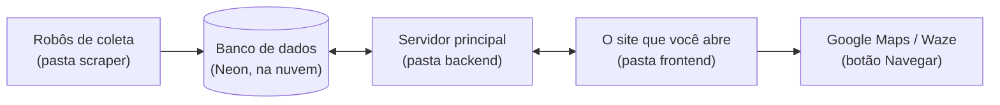

# SmartMarket em palavras simples

Guia para quem construiu (ou está ajudando a construir) o SmartMarket com apoio de IA e quer **entender o que existe, sem ler o código**. Se você sabe usar o site, já sabe o suficiente para começar aqui.

> Quer ver isso como um mapa que dá para clicar? Abra [`docs/mapa-smartmarket.html`](mapa-smartmarket.html) no navegador (veja [Como abrir o mapa](#10-como-abrir-o-mapa)).
> Precisa dos detalhes técnicos? Eles estão no [`CLAUDE.md`](../CLAUDE.md) e no [`README.md`](../README.md).

---

## 1. O que é o SmartMarket

Um site que mostra **onde cada produto de supermercado está mais barato** no Rio Grande do Sul e **qual loja fica mais perto de você**.

Para isso, o projeto faz três coisas:

1. **Anota preços.** Robôs visitam os sites dos supermercados e copiam produto e preço.
2. **Guarda tudo.** Os preços ficam num banco de dados, com histórico.
3. **Mostra e compara.** O site mostra o catálogo, compara as redes, guarda favoritos e monta a lista de compras.

## 2. As peças, de cima para baixo



| Peça | Pasta | O que faz, em uma frase | Uma comparação |
|---|---|---|---|
| **O site** | `frontend/` | É o que a pessoa vê e toca: catálogo, favoritos, lista, login. | A vitrine e o balcão da loja |
| **O servidor** | `backend/` | Recebe os pedidos do site, confere quem está logado, busca e grava no banco. | O gerente que atende cada pedido |
| **Os robôs** | `scraper/` | Visitam os sites dos supermercados, anotam preços, arrumam os nomes e gravam no banco. | Os funcionários que passam todo dia anotando preços de etiquetas |
| **O banco de dados** | `backend/database/` e `backend/deploy/` | Guarda produtos, preços, lojas e contas. Aqui ficam os textos que criam e mudam as tabelas. | O estoque e o arquivo de registros |
| **A publicação** | `.github/`, `render.yaml` | Coloca o site e o servidor no ar e confere se tudo funciona antes. | A equipe que abre a loja de manhã |
| **A documentação** | `docs/` | Explica o projeto, os testes e os cuidados. | O manual da casa |

## 3. O caminho de um preço, do supermercado até a sua tela

1. De madrugada, a **rotina diária** acorda os robôs.
2. Cada robô lê o site do seu supermercado e devolve uma lista de produtos com preço.
3. A **arrumação** padroniza os nomes ("Arroz Tio João 5kg" e "ARROZ TIO JOAO 5 KG" viram o mesmo produto) e separa registros com defeito numa **quarentena**, em vez de parar tudo.
4. O preço é **gravado**. Se for igual ao de ontem, só é "confirmado"; se mudou, entra no histórico.
5. Quando você abre o catálogo, o **servidor** entrega os preços e o **site** calcula o melhor preço e a rede mais perto.

## 4. Como o site descobre a loja mais perto

- No cadastro, você informa o **CEP**.
- O servidor pergunta a serviços públicos de endereço (BrasilAPI, ViaCEP e Nominatim, do OpenStreetMap) onde fica esse CEP.
- **Se não houver certeza da rua, o site guarda só a cidade e o estado.** Ele prefere não mostrar distância do que mostrar uma distância errada.
- A distância mostrada é **em linha reta** e aproximada (aparece como "≈ 2,3 km").
- O **preço vale para a rede inteira**. A loja mostrada é só uma referência de onde ir.
- O botão **Navegar** abre o Google Maps ou o Waze com o destino já preenchido. Ele nunca envia a sua posição para o SmartMarket.

## 5. Estado honesto do projeto

Coisas que o site faz hoje e coisas que ele **ainda não** faz:

- ✅ Compara preços entre redes, busca, favoritos, lista de compras, login e painel do administrador.
- ✅ Mostra a loja mais perto, por CEP ou pela localização atual do navegador.
- ⚠️ A coleta diária cobre **4 redes**: Carrefour, Atacadão, Master e Stok. **Zaffari, Rissul, Fort e Asun estão suspensas**: os sites delas proíbem ou bloqueiam o robô, e o projeto respeita isso. Os preços dessas quatro são antigos.
- ⚠️ Os **alertas de preço não enviam aviso** a ninguém ainda; só guardam o valor desejado.
- ⚠️ **Favoritos, alertas e lista de compras ficam no navegador** (a lista some ao fechar a aba). Trocar de computador não leva isso junto.
- ⚠️ O servidor roda no plano grátis e **dorme**. A primeira abertura depois de um tempo pode levar de 1 a 3 minutos, e o site mostra o aviso "servidor acordando".

## 6. O que **não** mexer sem combinar

| Não faça | Por quê |
|---|---|
| Editar `frontend/src/data.js` à mão | É um arquivo gerado, com mais de 30 MB, que se quebra fácil. Ele é refeito pelos coletores. |
| Contornar a trava do banco no `scraper/pipeline.py` | Ela só deixa gravar em banco **local**, para um computador de nuvem nunca alterar os preços de verdade. |
| Rodar os scripts de `backend/deploy/` por conta própria | Eles mudam o banco de produção. Só rodam por ordem do responsável, **na ordem dos números** (06, depois 07, depois 08), e com um backup antes. |
| Fazer o robô fingir ser um navegador, usar proxy ou trocar cabeçalhos para passar por um bloqueio | O contrato do projeto é **parar no primeiro bloqueio** e respeitar o `robots.txt`. |
| Colocar vídeos ou imagens grandes em `frontend/public` | O pacote do site passa de um limite e a publicação falha, mesmo sem nenhum teste vermelho. |
| Escrever senhas, chaves ou links com senha em arquivos do projeto | Qualquer coisa que entra no Git fica no histórico. Use o arquivo `.env`, que não é enviado. |
| Baixar o limite de **70% de cobertura de testes** | É um acordo do grupo. Código novo precisa de teste. |
| Trocar a cor verde-escura de textos pelo verde da marca | O verde da marca não tem contraste suficiente para leitura. |

## 7. Palavras que aparecem muito

| Palavra | Quer dizer |
|---|---|
| **Frontend** | O site que a pessoa vê. |
| **Backend / servidor** | A parte que trabalha por trás, sem ser vista. |
| **API** | O jeito de o site pedir coisas ao servidor ("me dá os preços deste produto"). |
| **Banco de dados** | Onde ficam guardados todos os registros. |
| **Scraper / coletor / robô** | Programa que visita um site e copia informações dele. |
| **Rede** | Uma marca de supermercado, como Zaffari ou Atacadão. |
| **Loja / filial** | Uma unidade física de uma rede. |
| **Deploy** | Colocar uma versão nova no ar. |
| **CI** | A conferência automática (testes) que roda em toda mudança antes de ela entrar. |
| **Pull request (PR)** | Um pedido para juntar a sua mudança ao projeto, para outra pessoa revisar. |
| **Branch** | Uma cópia paralela do projeto, onde você trabalha sem atrapalhar a principal (`main`). |
| **Migration** | Uma mudança na estrutura do banco, escrita como um script. |
| **JWT / token** | O "passe" que o site recebe ao entrar e mostra a cada pedido. |
| **CORS** | A lista de sites que podem conversar com o servidor. |
| **Cold start** | O servidor "acordando" depois de dormir. |
| **Cobertura de testes** | Quanto do código é conferido por testes automáticos. |

## 8. Como rodar no seu computador

Você precisa de **Node.js**, **Java 17** e **Docker**. Abra três terminais:

```bash
# 1) banco de dados de desenvolvimento
cd backend
docker compose --env-file ../.env up -d postgres

# 2) servidor (Windows: .\mvnw.cmd spring-boot:run)
./mvnw spring-boot:run

# 3) site, em http://localhost:5174
cd frontend
npm install
npm run dev
```

Antes do passo 2, o servidor precisa de duas variáveis no terminal: `SMARTMARKET_JWT_SECRET` (uma frase longa, de pelo menos 32 caracteres) e `POSTGRES_PASSWORD`. Se algo falhar, os detalhes estão em [`backend/README.md`](../backend/README.md).

> **Windows:** se o caminho da sua pasta tem o símbolo `&`, o `npm test` pode falhar. Use `node node_modules/jest/bin/jest.js` no lugar.

Para rodar tudo de uma vez: `docker compose up --build` na raiz.

## 9. Como pedir coisas ao Claude

Frases simples funcionam. Algumas que já ajudam muito neste projeto:

| Quero... | Peça assim |
|---|---|
| Entender uma parte | "Explique, sem termos técnicos, o que a tela de favoritos faz e de onde vêm os dados." |
| Saber o impacto de uma mudança | "Se eu mudar como o CEP é guardado, o que mais é afetado?" |
| Achar defeitos | "Use a skill cacar-bugs na pasta frontend/src/utils." |
| Revisar antes de enviar | "/code-review" e depois "/security-review" |
| Fazer uma mudança segura | "Faça de forma que eu possa desfazer, com um commit por item, e abra o PR como rascunho." |
| Atualizar este guia e o mapa | "Atualize o floorplan" |

Regra de ouro do grupo: **PR sempre em rascunho, nunca juntar sozinho, e o `data.js` não se mexe.**

## 10. Como abrir o mapa

O mapa é um arquivo único, que funciona **sem internet** e sem instalar nada:

1. Abra a pasta `docs/` do projeto.
2. Dê dois cliques em **`mapa-smartmarket.html`**.

Ele começa com um tour de um minuto. Dentro dele, você pode:

- clicar em uma peça para ver o que há dentro e o que a usa;
- usar **Flows** para ver, passo a passo, "Ver onde um produto está mais barato", "Criar conta e informar o CEP" e "A coleta diária de preços";
- usar **Screens** para partir de uma tela do site e ver tudo o que há por trás dela.

### Para atualizar o mapa depois de mexer no projeto

O mapa vem de uma ferramenta chamada [Floorplan](https://github.com/haydenschmitty/floorplan), que funciona dentro do Claude Code.

1. **Uma vez só:** instale o plugin.
   ```bash
   claude plugin marketplace add haydenschmitty/floorplan
   claude plugin install floorplan@floorplan
   ```
2. Abra uma sessão **nova** do Claude Code na pasta do projeto e peça: **"Atualize o floorplan."**
3. Para enviar uma cópia a alguém: **"Exporte o floorplan."** (a cópia não leva o código, só os nomes e as descrições).

A pasta `floorplan/` que a ferramenta cria **não vai para o Git**. O que fica no repositório é só a cópia pronta em `docs/mapa-smartmarket.html`.

## 11. Onde achar cada coisa

| Quero saber... | Leia |
|---|---|
| Todos os comandos e a arquitetura em detalhe | [`CLAUDE.md`](../CLAUDE.md) |
| Como publicar o site | [`DEPLOY-PAGES.md`](DEPLOY-PAGES.md) |
| Como o servidor sobe e quais variáveis ele pede | [`backend/DEPLOY.md`](../backend/DEPLOY.md) e [`backend/README.md`](../backend/README.md) |
| Como o banco de produção foi montado | [`PRODUCAO-NEON.md`](PRODUCAO-NEON.md) |
| Como funcionam as fotos e o catálogo na nuvem | [`ASSETS-NEON.md`](ASSETS-NEON.md) |
| Como funcionam os robôs e o que cada um respeita | [`scraper/README.md`](../scraper/README.md) e [`scraper/ROTINA-DE-CARGA.md`](../scraper/ROTINA-DE-CARGA.md) |
| Como os produtos iguais de redes diferentes são ligados | [`casamento-produtos.md`](casamento-produtos.md) |
| Onde ficam favoritos, alertas e lista | [`DADOS-LOCAIS-DO-USUARIO.md`](DADOS-LOCAIS-DO-USUARIO.md) |
| Como escrever e rodar testes | [`TESTES.md`](TESTES.md) |
| Quais lojas foram pesquisadas | [`PESQUISA-FILIAIS.md`](PESQUISA-FILIAIS.md) |
